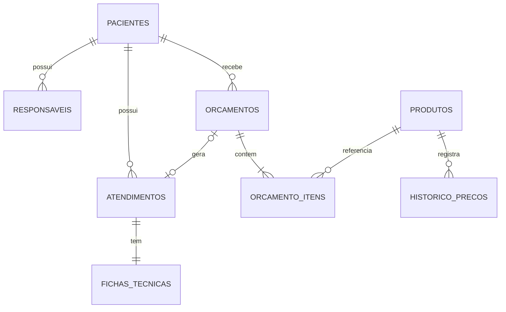

# Orto Fortino — Sistema de Gestão

> Cadastro de pacientes, atendimentos, tabela de preços e orçamentos em PDF para a **Orto Fortino — Órteses Funcionais**.


---

## Sumário

- [Sobre](#sobre)
- [Funcionalidades](#funcionalidades)
- [Stack](#stack)
- [Identidade visual](#identidade-visual)
- [Modelo de dados](#modelo-de-dados)
- [Regras de negócio](#regras-de-negócio)
- [Como rodar](#como-rodar)
- [Variáveis de ambiente](#variáveis-de-ambiente)
- [Estrutura de pastas](#estrutura-de-pastas)
- [Roadmap](#roadmap)
- [LGPD e segurança](#lgpd-e-segurança)
- [Convenções](#convenções)

---

## Sobre

Sistema interno, usado por 1 a 2 pessoas, que substitui as fichas em papel e as planilhas da Orto Fortino. Ele é dividido em duas partes:

| Módulo | Objetivo |
|---|---|
| **Pacientes e atendimentos** | Registrar o paciente e acompanhar cada serviço, do primeiro contato até o pagamento e a entrega |
| **Orçamentos** | Montar orçamentos com o paciente cadastrado e a tabela de preços, e gerar o PDF |

Design de referência (Login e Dashboard): https://claude.ai/artifact/XcG9FL1m3RJDaZs33ywgjG

---

## Funcionalidades

**Pacientes**
- [x] Cadastro com validação de CPF, data de nascimento (idade calculada) e origem (clínica, particular ou plano)
- [x] Responsáveis vinculados, para pacientes menores de idade
- [x] Busca por nome ou CPF e ficha com o histórico de atendimentos e orçamentos

**Atendimentos**
- [x] Categorias de serviço (confecção, ajuste, reparo, manutenção), incluindo serviços sem custo
- [x] Status: em contato → em produção → pronto → entregue
- [x] Datas de primeiro contato, fechamento, prazo de entrega e conclusão
- [x] Pagamento com status e forma de pagamento
- [x] Ficha técnica digital, baseada na ficha de montagem em papel
- [x] Filtros: em andamento, finalizados, pagamento pendente

**Tabela de preços**
- [x] Produtos-base e adicionais com preço editável
- [x] Histórico de preços
- [x] Importação inicial por planilha (CSV)

**Orçamentos**
- [x] Seleção de paciente e produtos, quantidade, desconto e itens avulsos
- [x] Preço editável por item, com a opção "salvar na tabela"
- [x] Subtotais por seção e total em tempo real
- [x] Versionamento após aprovação
- [ ] **Geração de PDF** com a marca da empresa

**Painel**
- [x] Indicadores: em produção, entregas da semana, a receber, orçamentos em aberto
- [x] Próximos prazos e atrasos

---

## Stack

| Camada | Tecnologia |
|---|---|
| Front-end | [React](https://react.dev) + [Vite](https://vite.dev) + TypeScript |
| Estilo | [Tailwind CSS](https://tailwindcss.com) |
| Rotas | React Router |
| Formulários | React Hook Form + Zod |
| Dados | TanStack Query |
| Back-end | [Supabase](https://supabase.com) (PostgreSQL, Auth, Row Level Security) |
| PDF | @react-pdf/renderer |
| Deploy | Vercel |

---

## Identidade visual

| Token | Cor | Uso |
|---|---|---|
| `brand-yellow` | `#FFD400` | Destaques e status "pronto" |
| `brand-orange` | `#F7941D` | Destaques e status "hoje / enviado" |
| `brand-pink` | `#E6007E` | Destaques e status "atrasado / pendente" |
| `brand-mint` | `#8FD5B4` | Cor principal da marca |
| `primary` | `#1F7A5C` | Botões e links (contraste AA) |
| `ink` | `#1F2A2E` | Texto principal |
| `muted` | `#55636A` | Texto secundário |
| `surface` | `#F5F8F6` | Fundo das páginas |

**Fontes:** Poppins (títulos) e Inter (texto).

---

## Modelo de dados



| Tabela | Descrição |
|---|---|
| `pacientes` | Dados pessoais, origem, médico/terapeuta, diagnóstico e consentimento LGPD |
| `responsaveis` | Responsável legal (nome, CPF, telefone) |
| `atendimentos` | Serviço, status, datas, prazo e pagamento |
| `fichas_tecnicas` | Produto, lateralidade, especificações, medidas e personalização |
| `produtos` | Tabela de preços (base ou adicional, ativo/inativo) |
| `historico_precos` | Alterações de preço ao longo do tempo |
| `orcamentos` | Número `ORC-AAAA-0001`, status, validade, desconto e versão |
| `orcamento_itens` | Itens com o preço copiado no momento do orçamento |
| `configuracoes` | Dados da empresa, textos e listas de opções |

---

## Regras de negócio

1. **Todos os valores são editáveis**: na tabela de preços e em cada item do orçamento.
2. **O preço é copiado** para o item do orçamento, então alterar a tabela não muda orçamentos antigos.
3. **Orçamento aprovado fica travado**: para alterá-lo, é criada uma nova versão (`-v2`).
4. Aprovar um orçamento **cria o atendimento** automaticamente.
5. Produtos em uso são **desativados**, nunca excluídos.
6. Atendimentos de **reparo** podem ter valor zero (sem custo).

---

## Como rodar

**Pré-requisitos:** Node.js 22 ou mais recente, uma conta no Supabase e o GitHub CLI (opcional).

```bash
git clone https://github.com/<usuario>/orto-fortino.git
cd orto-fortino
npm install
cp .env.example .env   # preencha com as chaves do Supabase
npm run dev
```

| Script | Descrição |
|---|---|
| `npm run dev` | Servidor de desenvolvimento |
| `npm run build` | Build de produção |
| `npm run preview` | Pré-visualização do build |
| `npm run lint` | Verificação de código |

---

## Variáveis de ambiente

```env
VITE_SUPABASE_URL=https://xxxx.supabase.co
VITE_SUPABASE_ANON_KEY=sua-anon-key
```

> ⚠️ Nunca faça commit do arquivo `.env`. Use o `.env.example` como modelo.

---

## Estrutura de pastas

```
orto-fortino/
├── public/
├── src/
│   ├── assets/            # logo e imagens
│   ├── components/        # componentes reutilizáveis (Button, Card, Input…)
│   ├── features/
│   │   ├── auth/
│   │   ├── dashboard/
│   │   ├── pacientes/
│   │   ├── atendimentos/
│   │   ├── produtos/
│   │   ├── orcamentos/
│   │   └── configuracoes/
│   ├── lib/               # cliente Supabase, utilitários (CPF, moeda, datas)
│   ├── pdf/               # templates de PDF
│   ├── routes/
│   └── main.tsx
├── supabase/
│   └── migrations/        # SQL versionado
├── .env.example
└── README.md
```

---

## Roadmap

| Fase | Entrega | Status |
|---|---|---|
| 0 | Fundação: projeto, tema, Supabase, Login e Dashboard | ✅ |
| 1 | Pacientes e responsáveis | ✅ |
| 2 | Atendimentos, ficha técnica e pagamento | ✅ |
| 3 | Dashboard com dados reais | ✅ |
| 4 | Tabela de preços editável | ✅ |
| 5 | Orçamentos | ✅ |
| 6 | PDF do orçamento | ⬜ |
| 7 | Configurações e ajustes | ⬜ |

**Depois do MVP:** PDF da ficha de montagem, envio por WhatsApp/e-mail, anexos (receitas, fotos) e relatórios de faturamento.

---

## LGPD e segurança

O sistema armazena **CPF e dados de saúde**, que são dados sensíveis pela LGPD. Por isso:

- Login obrigatório, sem cadastro público
- Row Level Security em todas as tabelas
- CPF mascarado nas listagens (`***.456.789-**`)
- Registro de autoria das alterações (`created_at`, `updated_at`, `updated_by`)
- Consentimento do paciente registrado no cadastro
- Repositório **privado**

---

## Convenções

- Commits em português, no padrão [Conventional Commits](https://www.conventionalcommits.org/pt-br) (`feat:`, `fix:`, `chore:`…)
- Branches: `feat/<nome>`, `fix/<nome>`
- Código em inglês e textos da interface em português

---

<p align="center">Orto Fortino · Órteses Funcionais · (21) 96497-3837 · ortofortino@hotmail.com</p>