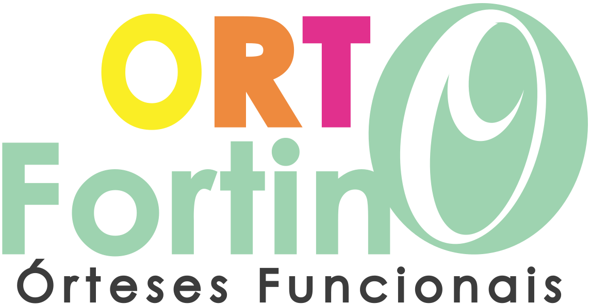
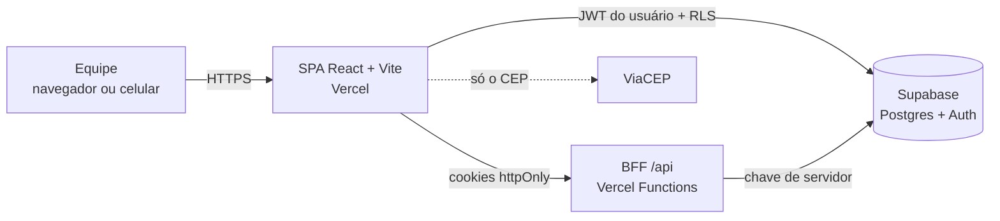
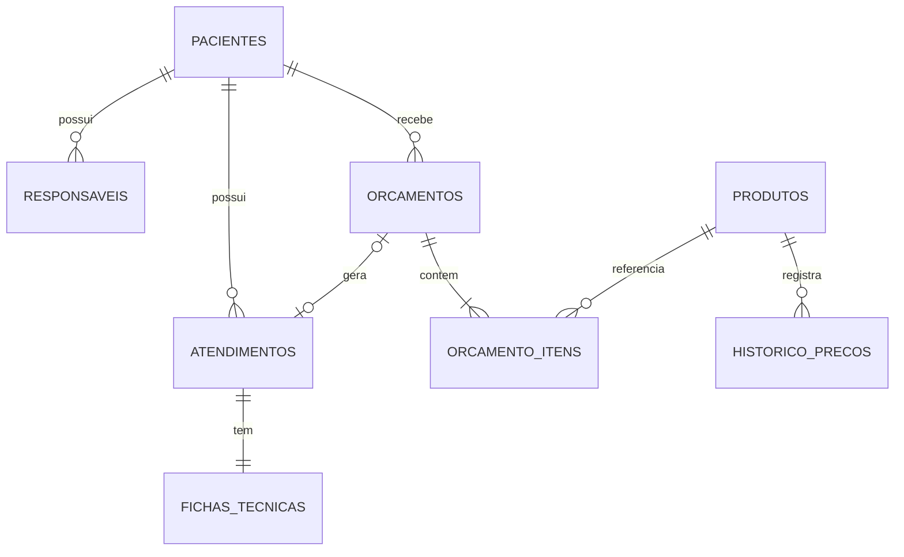

<div align="center">



### Do primeiro contato à entrega, tudo em um só lugar

Sistema de gestão para a **Orto Fortino — Órteses Funcionais**: cadastro de pacientes, atendimentos com ficha técnica digital, tabela de preços e orçamentos em PDF com a marca da empresa.


[Vídeo de apresentação](docs/video/apresentacao-orto-fortino.mp4) · [Arquitetura](docs/arquitetura.md) · [Segurança](SECURITY.md) · [Marca](docs/marca/README.md)

<br/>

<a href="docs/video/apresentacao-orto-fortino.mp4">
  
</a>

<sub>Clique na imagem para assistir à apresentação (1 min 20 s).</sub>

</div>

---

> **Este repositório é público e não contém dados reais.** Pacientes, CPFs e orçamentos ficam apenas no banco de dados da empresa, protegidos por login, verificação em duas etapas e Row Level Security. Os dados usados em testes e no vídeo são fictícios.

## Sumário

1. [Visão geral](#1-visão-geral)
2. [Funcionalidades](#2-funcionalidades)
3. [Arquitetura](#3-arquitetura)
4. [Stack](#4-stack)
5. [Modelo de dados](#5-modelo-de-dados)
6. [Regras de negócio](#6-regras-de-negócio)
7. [Identidade visual](#7-identidade-visual)
8. [Como executar](#8-como-executar)
9. [Testes](#9-testes)
10. [Segurança e privacidade](#10-segurança-e-privacidade)
11. [Estrutura do repositório](#11-estrutura-do-repositório)
12. [Roadmap](#12-roadmap)
13. [Convenções](#13-convenções)
14. [Licença](#14-licença)

---

## 1. Visão geral

Sistema interno, usado por 1 a 2 pessoas, que substitui as fichas em papel e as planilhas da Orto Fortino. Funciona no computador e no celular.

| Módulo | Objetivo |
|---|---|
| **Pacientes e atendimentos** | Registrar o paciente e acompanhar cada serviço, do primeiro contato ao pagamento e à entrega |
| **Orçamentos** | Montar orçamentos com o paciente cadastrado e a tabela de preços, e gerar o PDF |
| **Painel** | Mostrar o dia: produção, entregas da semana, valores a receber e prazos atrasados |
| **Configurações** | Dados da empresa, padrões do orçamento, listas da ficha técnica e segurança da conta |

## 2. Funcionalidades

**Pacientes**
- [x] Cadastro com validação de CPF, idade calculada e origem (clínica, particular ou plano)
- [x] Responsáveis vinculados, para pacientes menores de idade
- [x] Busca por nome ou CPF e ficha com o histórico de atendimentos e orçamentos
- [x] CEP preenche o endereço automaticamente (ViaCEP)

**Atendimentos**
- [x] Categorias: confecção, ajuste, reparo e manutenção, inclusive sem custo
- [x] Status: em contato → em produção → pronto → entregue
- [x] Datas de contato, fechamento, prazo e conclusão
- [x] Pagamento com status, forma (Pix, dinheiro, crédito com parcelas, débito) e filtros
- [x] Ficha técnica digital, baseada na ficha de montagem em papel, com prévia viva da órtese

**Tabela de preços**
- [x] Produtos-base e adicionais com preço editável e histórico de preços
- [x] Importação por planilha (`.csv` e `.xlsx`)

**Orçamentos**
- [x] Itens da tabela ou avulsos, quantidade, desconto e preço editável por item
- [x] Subtotais por seção e total em tempo real
- [x] Versionamento depois da aprovação
- [x] **PDF** com a marca e o cabeçalho da empresa
- [x] Rascunho automático: o formulário continua de onde parou

**Painel e configurações**
- [x] Indicadores, próximos prazos, atrasos e valores a receber
- [x] Padrões do orçamento (validade, condições, prazo e observações)
- [x] Minha conta, troca de senha e verificação em duas etapas opcional (app autenticador)

## 3. Arquitetura



- **SPA:** telas, formulários e geração do PDF no navegador.
- **BFF (`/api`):** login, renovação de sessão, MFA e redefinição de senha. Os tokens ficam em cookies `httpOnly`, fora do alcance do JavaScript da página, e a chave de servidor do Supabase nunca chega ao navegador.
- **Supabase:** Postgres com RLS em todas as tabelas. Quem ativou a verificação em duas etapas só lê os dados com o nível `aal2`.

Detalhes e decisões: [`docs/arquitetura.md`](docs/arquitetura.md).

## 4. Stack

| Camada | Tecnologia |
|---|---|
| Front-end | [React](https://react.dev) 19, [Vite](https://vite.dev) e TypeScript |
| Estilo | [Tailwind CSS](https://tailwindcss.com) 4 |
| Rotas e dados | React Router e TanStack Query |
| Formulários | React Hook Form e Zod |
| Back-end | [Supabase](https://supabase.com) (PostgreSQL, Auth, RLS) e BFF em Vercel Functions |
| PDF | `@react-pdf/renderer` |
| Planilhas | `read-excel-file` |
| Qualidade | Vitest, Playwright, axe, Lighthouse CI, oxlint e secretlint |
| Deploy | Vercel (região `gru1`) |

## 5. Modelo de dados



| Tabela | Descrição |
|---|---|
| `pacientes` | Dados pessoais, origem, médico ou terapeuta, diagnóstico e consentimento LGPD |
| `responsaveis` | Responsável legal (nome, CPF, telefone) |
| `atendimentos` | Serviço, status, datas, prazo e pagamento |
| `fichas_tecnicas` | Produto, lateralidade, especificações, medidas e personalização |
| `produtos` | Tabela de preços (base ou adicional, ativo ou inativo) |
| `historico_precos` | Alterações de preço ao longo do tempo |
| `orcamentos` | Número `ORC-AAAA-0001`, status, validade, desconto e versão |
| `orcamento_itens` | Itens com o preço copiado no momento do orçamento |
| `configuracoes` | Dados da empresa, textos e listas de opções |

O esquema é versionado em [`supabase/migrations/`](supabase/migrations).

## 6. Regras de negócio

1. **Todos os valores são editáveis**, na tabela de preços e em cada item do orçamento.
2. **O preço é copiado** para o item do orçamento; mudar a tabela não altera orçamentos antigos.
3. **Orçamento aprovado fica travado**: para alterá-lo, cria-se uma nova versão (`-v2`).
4. Aprovar um orçamento **cria o atendimento** automaticamente.
5. Produtos em uso são **desativados**, nunca excluídos.
6. Atendimentos de **reparo** podem ter valor zero.

## 7. Identidade visual

| Token | Cor | Uso |
|---|---|---|
| `brand-yellow` | `#FFD400` | Destaques e status "pronto" |
| `brand-orange` | `#F7941D` | Destaques e status "hoje" |
| `brand-pink` | `#E6007E` | Destaques e status "atrasado" ou "pendente" |
| `brand-mint` | `#8FD5B4` | Cor principal da marca |
| `primary` | `#1F7A5C` | Botões e links (contraste AA) |
| `ink` / `muted` / `surface` | `#1F2A2E` / `#55636A` / `#F5F8F6` | Texto e fundo |

**Fontes:** Poppins (títulos) e Inter (texto), servidas localmente. Arquivos da marca em [`docs/marca/`](docs/marca/README.md).

## 8. Como executar

**Pré-requisitos:** Node.js 22 ou mais recente e um projeto no Supabase.

```bash
git clone https://github.com/Provadelli/OrtoFortino-System.git
cd OrtoFortino-System
npm install
cp .env.example .env.local     # preencha com as chaves do SEU projeto Supabase
npx supabase db push           # aplica as migrações (supabase login e link antes)
npm run user:create            # cria o primeiro usuário (não há cadastro público)
npm run dev                    # http://localhost:5173
```

| Script | Descrição |
|---|---|
| `npm run dev` | Servidor de desenvolvimento (inclui o BFF `/api`) |
| `npm run build` | Checagem de tipos e build de produção |
| `npm run preview` | Pré-visualização do build |
| `npm run typecheck` / `npm run lint` | TypeScript e oxlint |
| `npm test` | Testes unitários e do BFF (Vitest) |
| `npm run test:e2e` | Testes ponta a ponta e de acessibilidade (Playwright) |
| `npm run secrets:check` | Varredura de segredos (secretlint) |
| `npm run lighthouse` | Lighthouse CI |
| `npm run user:create` | Cria um usuário da equipe |
| `npm run user:reset-mfa` | Desativa a verificação em duas etapas de quem perdeu o celular |

**Variáveis de ambiente** (modelo em [`.env.example`](.env.example)):

| Variável | Onde vai | Observação |
|---|---|---|
| `VITE_SUPABASE_URL`, `VITE_SUPABASE_PUBLISHABLE_KEY` | Navegador | Públicas; protegidas pelo RLS |
| `VITE_WHATSAPP_SUPORTE` | Navegador | WhatsApp do suporte (só dígitos); fica fora do código |
| `SUPABASE_URL`, `SUPABASE_PUBLISHABLE_KEY` | Servidor (BFF) | Sem prefixo `VITE_` |
| `SUPABASE_SECRET_KEY` | Servidor (BFF) | **Secreta.** Nunca no navegador nem no git |
| `APP_ORIGIN` | Servidor (BFF) | Origem permitida (proteção CSRF) |

> **Atenção:** o `.env.local` é ignorado pelo git. Nunca versione chaves reais.

## 9. Testes

| Tipo | Comando | Cobertura |
|---|---|---|
| Unitários e BFF | `npm test` | 149 testes em 11 arquivos: CPF, CEP, moeda, cálculo e PDF do orçamento, produtos, autenticação, rascunho e API |
| Ponta a ponta | `npm run test:e2e` | Login, pacientes, atendimentos, produtos, orçamentos, painel, configurações e layout |
| Acessibilidade | `npm run test:e2e` | axe (WCAG) nas telas principais |
| Desempenho | `npm run lighthouse` | Lighthouse CI com metas em `lighthouserc.json` |
| Segredos | `npm run secrets:check` | secretlint, também no *pre-commit* (Husky + lint-staged) |

Os testes ponta a ponta criam e apagam dados fictícios. Rode-os apenas contra um projeto Supabase de desenvolvimento, nunca contra o de produção.

## 10. Segurança e privacidade

O sistema guarda **CPF e dados de saúde**, que são dados sensíveis pela LGPD.

**Acesso**
- Login obrigatório, sem cadastro público
- Verificação em duas etapas opcional; quem ativa só acessa os dados com o código, exigido também no banco (RLS `aal2`)
- Tokens em cookies `httpOnly` pelo BFF, proteção CSRF por origem e limite de tentativas de login

**Dados**
- Row Level Security em todas as tabelas
- CPF mascarado nas listagens (`***.456.789-**`)
- Registro de autoria das alterações (`created_at`, `updated_at`, `updated_by`)
- Consentimento do paciente registrado no cadastro
- ViaCEP recebe só os 8 números do CEP, sem cookies nem *referer*

**Navegador** (cabeçalhos em [`vercel.json`](vercel.json))
- CSP restrita ao próprio site, ao Supabase e ao ViaCEP; `wasm-unsafe-eval` libera apenas WebAssembly (gerador de PDF)
- HSTS, `X-Frame-Options: DENY`, `nosniff`, `Referrer-Policy: no-referrer`, COOP/CORP e `Permissions-Policy` fechada

**Segredos**
- `.env*` ignorados pelo git; só o `.env.example` (com marcadores) é versionado
- `SUPABASE_SECRET_KEY` existe apenas no servidor
- secretlint no *pre-commit* (Husky + lint-staged); histórico do repositório verificado antes de ser aberto

Para reportar uma vulnerabilidade, veja [`SECURITY.md`](SECURITY.md).

## 11. Estrutura do repositório

```text
OrtoFortino-System/
├── api/                    BFF (Vercel Functions): auth/, empresa.ts e _lib/
├── src/
│   ├── app/                rotas e proteção de rotas
│   ├── components/         brand, layout e ui (Button, Card, Combobox…)
│   ├── features/           auth, dashboard, pacientes, atendimentos,
│   │                       produtos, orcamentos (com pdf/) e configuracoes
│   ├── lib/                Supabase, CPF/CEP, formatação, rascunho
│   └── styles/             Tailwind e fontes
├── supabase/
│   ├── migrations/         esquema SQL versionado, com RLS
│   └── templates/          e-mail de recuperação de senha
├── tests/                  unit/, api/, e2e/ e support/
├── scripts/                create-user, reset-mfa e servidor de dev do BFF
├── docs/
│   ├── arquitetura.md
│   ├── marca/              logo, símbolo e originais
│   └── video/              vídeo de apresentação e capa
├── public/                 favicons e rabiscos
├── .env.example            modelo das variáveis (sem segredos)
├── SECURITY.md
├── LICENSE
└── README.md
```

## 12. Roadmap

| Fase | Entrega | Status |
|---|---|---|
| 0 | Fundação: projeto, tema, Supabase, login e painel | ✅ |
| 1 | Pacientes e responsáveis | ✅ |
| 2 | Atendimentos, ficha técnica e pagamento | ✅ |
| 3 | Painel com dados reais | ✅ |
| 4 | Tabela de preços editável | ✅ |
| 5–6 | Orçamentos e PDF | ✅ |
| 7 | Configurações, conta e verificação em duas etapas | ✅ |
| 8 | Acabamento: PDF em produção, planilhas, CEP e campos formatados | ✅ |
| 9 | Design: ficha visual, rabiscos, login animado e listas de pagamento | ✅ |

**Próximos passos:** PDF da ficha de montagem, envio por WhatsApp ou e-mail, anexos (receitas e fotos) e relatórios de faturamento.

## 13. Convenções

- Commits em português, no padrão [Conventional Commits](https://www.conventionalcommits.org/pt-br) (`feat:`, `fix:`, `chore:`…)
- Branches: `feat/<nome>` e `fix/<nome>`
- Código em inglês e textos da interface em português

## 14. Licença

**Todos os direitos reservados.** O código está público para consulta e portfólio; uso, cópia ou redistribuição dependem de autorização. Veja [`LICENSE`](LICENSE).

A marca e a logo da Orto Fortino pertencem à empresa.
