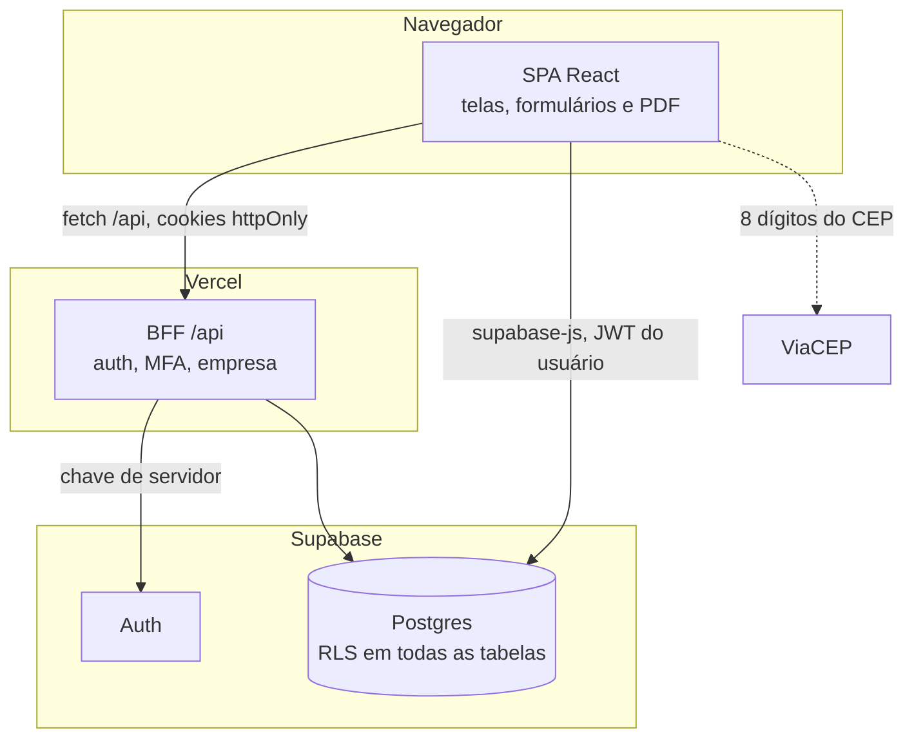

# Arquitetura

Visão geral das camadas do Orto Fortino e das decisões de segurança que as moldam.

## Camadas

## Decisões

| Decisão | Motivo |
|---|---|
| **BFF em `/api` para autenticação** | Os tokens ficam em cookies `httpOnly`; o JavaScript da página não os lê, o que reduz o impacto de XSS |
| **Chave de servidor só no BFF** | `SUPABASE_SECRET_KEY` ignora o RLS e nunca pode ir para o navegador |
| **RLS em todas as tabelas** | A regra de acesso mora no banco, não só na interface |
| **MFA opcional com `aal2` no RLS** | Quem ativa o segundo fator só acessa os dados após o código, também no banco |
| **CSRF por `APP_ORIGIN`** | O BFF recusa chamadas de outras origens |
| **Limite de tentativas no banco** | `auth_rate_*` (migração `…000002_auth_rate_limit.sql`) freia força bruta |
| **Preço copiado para o item do orçamento** | Alterar a tabela de preços não muda orçamentos antigos |
| **CSP sem `unsafe-eval`** | Só `wasm-unsafe-eval`, necessário ao gerador de PDF |

## Pastas

- `api/auth/*`: login, logout, refresh, esqueci a senha, redefinição, MFA e conta.
- `api/_lib/*`: cookies, HTTP, rate limit, cliente Supabase e MFA (o prefixo `_` impede que virem rotas).
- `src/features/*`: um módulo por área, cada um com tela, `api.ts` e `schema.ts` (Zod).
- `supabase/migrations/*`: esquema e políticas RLS, na ordem do prefixo de data.

## Fluxo de login

1. A SPA envia e-mail e senha para `POST /api/auth/login`.
2. O BFF valida a origem, aplica o limite de tentativas e autentica no Supabase.
3. Se houver MFA, a sessão fica em `aal1` até `POST /api/auth/mfa` confirmar o código.
4. O BFF grava os tokens em cookies `httpOnly` e devolve só os dados da sessão.
5. O banco aplica o RLS usando o nível de autenticação do token.
